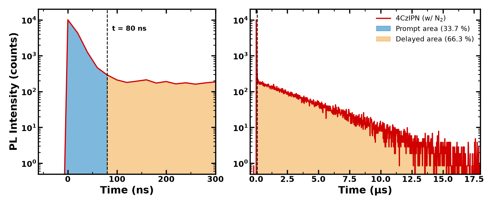
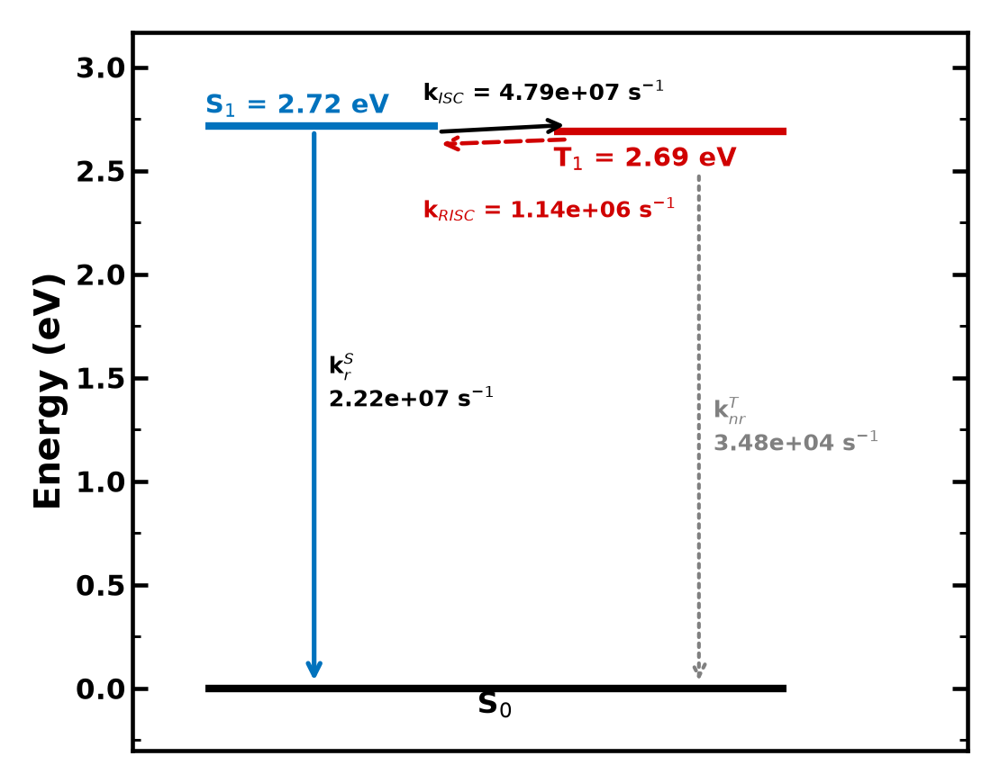
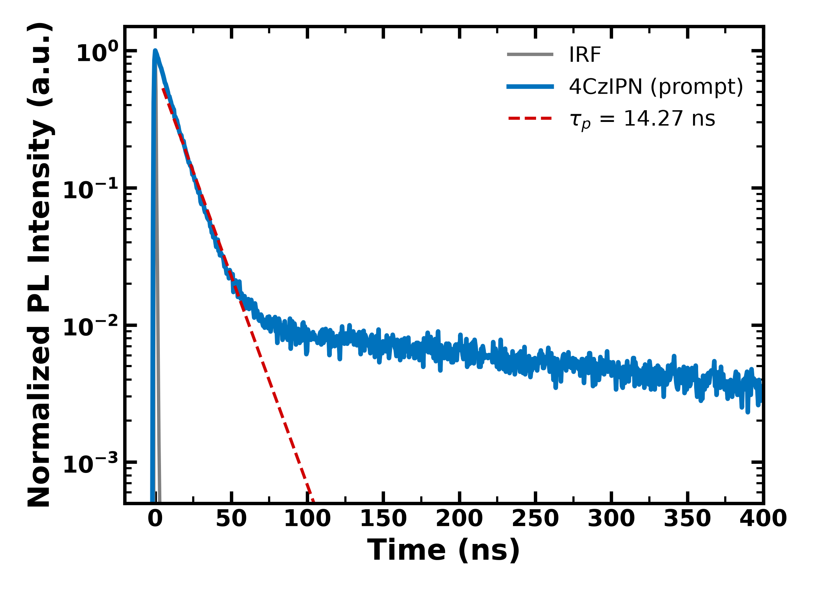
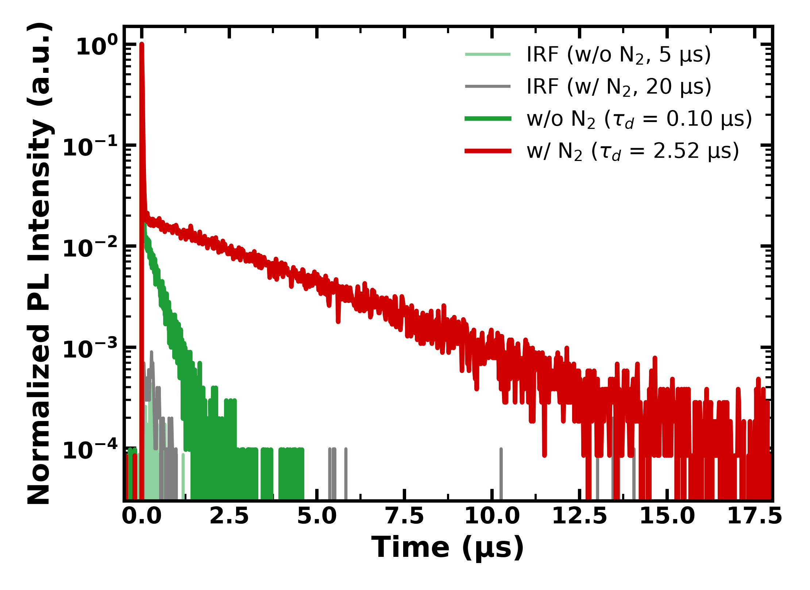
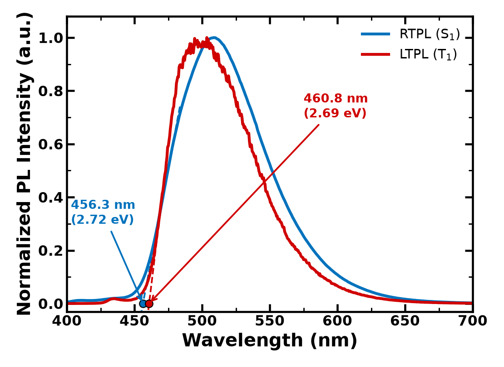

# OLED 실험 7주차 — TADF Exciton Lifetime 측정 및 Rate Constant 계산

**작성자:** 이영빈 **학번:** 2023101942

> 측정 시료: 지연형광(TADF) 재료 **4CzIPN** (toluene, 10⁻⁴ M)
> 측정: RTPL / LTPL 스펙트럼, Time-Resolved PL(TRPL, single photon counting, λex = 365 nm, λem = 507 nm)

---

## Ⅰ. 실험 목적

- Single photon counting 방식의 Time-Resolved Photoluminescence(TRPL)로 TADF 재료 4CzIPN의 exciton lifetime(τp, τd)을 측정하고 그 의미를 이해한다.
- 측정한 lifetime과 PLQY로부터 들뜬상태의 rate constant(kp, kd, kr^S, kISC, kRISC, knr^T)를 계산한다.
- 상온·저온 PL 스펙트럼에서 S1과 T1을 구하고 ΔEST를 도출하여 TADF가 일어나는 조건을 확인한다.

---

## Ⅱ. 실험 원리

### A. Quantum yield

Quantum yield는 물질이 흡수한 광자 수에 대해 일어난 변화의 수의 비율이다. 광물리 과정에서는 흡수한 광자 수 대비 S1 또는 T1에서 방출된 형광·인광 광자 수를 뜻한다. 본 실험에서 4CzIPN의 전체 PLQY(Φ_total)는 94 %이며, 이는 prompt 형광과 delayed 형광의 양자효율 합이다.

```
Φ_total = Φp + Φd
```

### B. Thermally Activated Delayed Fluorescence (TADF)

일반 형광은 singlet 들뜬상태에서 ns 수준의 수명으로 발광한다. 그런데 일부 재료는 같은 형광 파장에서 μs 수준의 긴 수명을 갖는 발광을 추가로 보이는데, 이를 지연형광이라 한다. 지연형광이 가능한 이유는 ISC로 T1에 쌓인 triplet exciton이 **역계간전이(RISC, reverse intersystem crossing)** 로 다시 S1이 된 뒤 형광으로 발광하기 때문이다.

보통 S1이 T1보다 에너지가 높아 S1 → T1 방향의 ISC가 주로 일어난다. 그러나 S1과 T1의 에너지 차이 ΔEST가 충분히 작으면 상온의 열에너지로 T1 → S1 전이가 일어날 수 있다. 이 과정을 TADF라 하며, 대략 **ΔEST ≲ 0.3 eV**일 때 가능하다고 알려져 있다. 전기 여기 시 생성되는 exciton의 75 %가 triplet이므로, TADF 재료는 이 triplet까지 형광으로 바꿔 이론적으로 내부양자효율 100 %에 가까워질 수 있다.

### C. 들뜬상태의 kinetics

형광 exciton의 수명과 양자효율은 다음과 같다.

```
τF = 1 / (kF + kIC + kISC) = 1 / (kF + kNR)          (1), (2)
ΦF = kF / (kF + kIC + kISC)                           (3)
```

TADF 재료의 발광은 수명이 짧은 **prompt 성분(τp)** 과 수명이 긴 **delayed 성분(τd)** 으로 나뉜다. Delayed 성분의 속도상수와 양자효율은 다음 식으로 표현된다.

```
1/τd = kd = knr^T + (1 − kISC / (kr^S + knr^S + kISC)) · kRISC      (4)

Φd = Σ (ΦISC·ΦRISC)^k · Φp = [ΦISC·ΦRISC / (1 − ΦISC·ΦRISC)] · Φp    (5)
```

여기서 knr^T는 T1의 비발광 속도상수, kr^S와 knr^S는 S1의 발광·비발광 속도상수이다. 식 (5)는 exciton이 S1 ↔ T1을 여러 번 오가며 매 순환마다 일부가 형광으로 나간다는 뜻이다. 따라서 지연형광의 세기와 수명은 triplet이 비발광으로 소멸하지 않고 얼마나 많이 RISC 되는지에 따라 결정된다.

### D. TRPL과 IRF

TRPL은 pulse 광원으로 시료를 여기한 뒤, 단일 광자가 검출되기까지의 시간을 반복 측정해 히스토그램으로 쌓는 방식(time-correlated single photon counting)으로 발광 세기의 시간 변화를 얻는다. 측정 곡선에는 광원 pulse 폭과 검출기 응답이 섞여 있으므로, 산란 시료로 장비 응답 함수(IRF, Instrument Response Function)를 따로 측정하고 이를 고려해(deconvolution) fitting 해야 정확한 τ를 얻는다.

### E. S1, T1 결정

- **S1**: 상온 PL(RTPL)은 형광이므로, 스펙트럼의 단파장 쪽 가장자리(onset)에서 S1 에너지를 구한다.
- **T1**: 저온에서 지연 시간을 두고 측정한 PL(LTPL)은 수명이 긴 인광 성분이 주가 되므로, 그 onset에서 T1 에너지를 구한다.

```
E [eV] = 1240 / λonset [nm]
ΔEST = E(S1) − E(T1)
```

---

## Ⅲ. 실험 방법

### A. 기구 및 재료

| 구분 | 항목 |
|------|------|
| 측정 장비 | Time-resolved photoluminescence 측정 장비(Hamamatsu, U11487-01 프로그램), PL spectrometer(JASCO) |
| 기구 | 전자저울, 피펫, vial, side arm cell |
| 시료 | 지연형광재료 4CzIPN, 용매 toluene |

### B. 실험 과정

1. 4CzIPN을 toluene에 10⁻⁴ M 농도로 녹인다.
2. U11487-01 프로그램을 실행하고 board select에서 TCC900 모드를 확인한다.
3. 시료를 담은 side arm cell을 TRPL 장비의 샘플 박스에 장착한다.
4. Spectrum measurement에서 여기 파장(장비 고정값 중 가장 가까운 365 nm)과 repetition 10 kHz를 설정해 발광 스펙트럼을 측정한다.
5. Lifetime measurement에서 같은 설정에 emission 파장을 λmax(507 nm)로 입력하고 측정한다.
6. IRF measurement로 IRF를 측정한다.
7. 측정 구간과 fitting order를 정해 τ를 도출한다. 측정은 prompt(500 ns 구간), N2 bubbling 없는 delayed(5 μs 구간), N2 bubbling 후 delayed(20 μs 구간) 세 가지로 진행했다.

---

## Ⅳ. 실험 결과

### 1. 지연 형광 재료 4CzIPN의 exciton lifetime (τp, τd)을 측정하고 이를 이용하여 kp, kd, kr^S, kISC, kRISC, knr^T를 구하시오.

**측정한 lifetime (TRPL fitting 결과)**

| 성분 | 측정 구간 | τ |
|------|-----------|---|
| Prompt fluorescence | 500 ns | **τp = 14.2687 ns** |
| Delayed fluorescence (N2 bubbling 없음) | 5 μs | τd = 0.0997 μs |
| Delayed fluorescence (N2 bubbling 진행) | 20 μs | **τd = 2.52191 μs** |

Rate constant 계산에는 산소의 영향을 제거한 τp와 τd(N2 bubbling)를 사용한다.

**양자효율의 분리.** 전체 PLQY는 Φ_total = 0.94이다. TCSPC로 측정한 TRPL 곡선의 세기는 단위 시간에 검출된 광자 수이므로, 곡선 아래 면적은 그 구간에 방출된 광자 수에 비례한다. 따라서 N2 bubbling 후 20 μs 구간 데이터에서 prompt 구간과 delayed 구간의 면적비로 Φ_total을 나누었다. 두 구간의 경계는 데이터가 τd = 2.52 μs의 delayed 지수 감쇠선에 합류하는 시점(peak 후 80 ns)으로 정했다. 이 시점에서 prompt 성분은 e^(−80/14.27) ≈ 0.4 %만 남아 있어 경계 선택에 따른 오차가 작다.

**Fig. 1 — TRPL 면적을 이용한 prompt / delayed 성분 분리 (w/ N2, 20 μs 구간)**



| 구간 | 적분 면적 (counts·ns) | 비율 |
|------|------------------------|------|
| Prompt (0 ~ 80 ns) | 3.21 × 10⁵ | 33.7 % |
| Delayed (80 ns 이후) | 6.31 × 10⁵ | 66.3 % |

```
Φp = 0.94 × 0.337 = 0.317
Φd = 0.94 × 0.663 = 0.623
```

**계산 과정.** PLQY가 94 %로 매우 높으므로 S1의 비발광 과정은 무시한다(knr^S ≈ 0). 그러면 S1에서 빠져나가는 경로는 발광과 ISC 두 가지이다.

```
kp     = 1/τp = 1 / (14.2687 × 10⁻⁹ s)            = 7.01 × 10⁷ s⁻¹
kd     = 1/τd = 1 / (2.52191 × 10⁻⁶ s)            = 3.97 × 10⁵ s⁻¹

kr^S   = Φp · kp        = 0.317 × 7.01 × 10⁷      = 2.22 × 10⁷ s⁻¹
kISC   = (1 − Φp) · kp  = 0.683 × 7.01 × 10⁷      = 4.79 × 10⁷ s⁻¹

kRISC  = (kp · kd · Φd) / (kISC · Φp)
       = (7.01×10⁷ × 3.97×10⁵ × 0.623) / (4.79×10⁷ × 0.317)
                                                  = 1.14 × 10⁶ s⁻¹

knr^T  = kd − Φp · kRISC          (식 (4)에서 1 − ΦISC = Φp)
       = 3.97 × 10⁵ − 0.317 × 1.14 × 10⁶           = 3.48 × 10⁴ s⁻¹
```

**검산.** 위 값으로 ΦISC = kISC/kp = 0.683, ΦRISC = kRISC/(kRISC + knr^T) = 0.970이다. 이를 식 (5)에 넣으면 Φd = [0.683 × 0.970 / (1 − 0.683 × 0.970)] × 0.317 = 0.623으로, 면적비로 구한 Φd와 일치한다.

**Table 1 — 4CzIPN의 rate constant**

| Rate constant | 값 (s⁻¹) | 의미 |
|---------------|-----------|------|
| kp | 7.01 × 10⁷ | prompt 성분 감쇠 속도 |
| kd | 3.97 × 10⁵ | delayed 성분 감쇠 속도 |
| kr^S | 2.22 × 10⁷ | S1 → S0 발광 |
| kISC | 4.79 × 10⁷ | S1 → T1 계간전이 |
| kRISC | 1.14 × 10⁶ | T1 → S1 역계간전이 |
| knr^T | 3.48 × 10⁴ | T1 비발광 소멸 |

**Fig. 2 — 계산한 rate constant를 표시한 에너지 다이어그램**



kRISC(1.14 × 10⁶ s⁻¹)가 knr^T(3.48 × 10⁴ s⁻¹)보다 약 33배 크다. 즉 T1에 모인 exciton의 97 %가 비발광으로 사라지지 않고 다시 S1으로 돌아간다(ΦRISC = 0.970). kISC가 kr^S보다 약 2.2배 커서 S1 exciton의 68 %가 일단 T1으로 넘어가지만, 높은 ΦRISC 덕분에 결국 지연형광으로 발광한다. 그 결과 지연형광이 전체 발광의 약 2/3를 차지하고 전체 PLQY가 94 %에 이른다.

**Table 2 — 문헌값(Uoyama et al., 2012)과의 비교**

| 항목 | 실험값 | 문헌값 | 오차율 |
|------|--------|--------|--------|
| τp | 14.27 ns | 17.8 ns | 19.8 % |
| τd | 2.52 μs | 5.1 μs | 50.6 % |
| PLQY | 94 % | 94 % | 0 % |

두 τ가 모두 문헌값보다 짧고, 특히 τd의 차이가 크다. τd는 triplet이 T1에 머무는 동안의 소멸 과정에 민감하므로, N2 bubbling 후에도 용액에 남은 소량의 산소가 triplet을 일부 소광했을 가능성이 가장 크다. 그 밖에 fitting 구간과 order 선택, 용액 농도의 차이도 영향을 주었을 것이다. τd가 짧게 측정되면 kd가 커지고, 그만큼 kRISC와 knr^T도 함께 커지는 방향으로 계산된다.

### 2. Time resolved PL 그래프를 통해서 지연형광재료 4CzIPN의 발광 현상을 분석하시오.

**Fig. 3 — Prompt 구간(500 ns) TRPL**



**Fig. 4 — Delayed 구간 TRPL (N2 bubbling 전/후)**



- **두 가지 감쇠 성분.** Fig. 3에서 발광은 IRF와 함께 즉시 올라간 뒤 τp = 14.27 ns의 단일 지수로 약 50 ns까지 두 자릿수(10⁰ → 10⁻²) 감소한다. 그 뒤 곡선이 꺾여 최대값의 약 10⁻² 수준에서 매우 천천히 줄어드는 꼬리가 이어진다. 이 꼬리가 μs 수명의 delayed 성분이다. 같은 파장(507 nm)에서 ns와 μs 두 성분이 함께 관측된다는 것은, 같은 S1에서 나오는 형광이 두 경로로 만들어진다는 뜻이다.
- **Prompt 성분.** 광여기로 직접 생성된 S1 exciton이 바로 발광(kr^S)하거나 ISC로 T1이 되며 사라지는 과정이다. 수명은 kp = kr^S + kISC로 정해진다.
- **Delayed 성분.** Fig. 4의 N2 bubbling 데이터에서 delayed 성분은 약 15 μs 동안 세 자릿수 이상 단일 지수(τd = 2.52 μs)로 감소한다. τd가 τp보다 약 180배 길다. T1으로 넘어간 exciton이 RISC로 S1에 돌아와 발광하는 과정이 반복되므로, 발광 파장은 형광과 같지만 수명은 triplet이 S1으로 돌아오는 속도에 의해 결정된다.
- **산소의 영향.** N2 bubbling을 하지 않은 시료는 delayed 성분의 수명이 0.10 μs로 약 25배 짧아지고 세기도 빠르게 사라진다. 반면 prompt 성분은 큰 변화가 없다. 산소가 triplet exciton을 선택적으로 소광한다는 뜻이며, 이는 delayed 성분이 triplet을 거쳐 나오는 TADF임을 보여주는 직접적인 증거이다.

정리하면 4CzIPN의 발광은 ns 수명의 prompt 형광과 RISC를 거친 μs 수명의 지연형광으로 이루어지며, 지연형광이 산소에 민감하다는 점에서 TADF 재료임을 확인할 수 있다.

### 3. 지연형광 재료 4CzIPN의 PL 스펙트럼을 통해서 S1과 T1을 각각 구하고 ΔEST를 도출하시오.

**Fig. 5 — 4CzIPN의 RTPL / LTPL 스펙트럼과 onset 작도**



각 스펙트럼의 단파장 쪽 상승부에서 기울기가 가장 큰 지점에 접선을 긋고, 접선이 x축(세기 0)과 만나는 파장을 onset으로 정했다.

| 스펙트럼 | λmax | λonset | 에너지 |
|----------|------|--------|--------|
| RTPL (형광) | 509.0 nm | 456.3 nm | **S1 = 1240 / 456.3 = 2.72 eV** |
| LTPL (인광, 30 ms delay) | 503.5 nm | 460.8 nm | **T1 = 1240 / 460.8 = 2.69 eV** |

```
ΔEST = S1 − T1 = 2.718 − 2.691 = 0.027 eV  (27 meV)
```

ΔEST는 TADF가 가능한 기준(약 0.3 eV)보다 훨씬 작고, 상온 열에너지 kT(약 26 meV)와 비슷하다. 그래서 T1의 exciton이 상온에서 쉽게 S1으로 올라갈 수 있으며, 결과 1에서 kRISC가 knr^T보다 약 33배 크게 나온 것과도 맞는다. **Table 3 — 문헌값과의 비교**

| 항목 | 실험값 | 문헌값 (Uoyama et al., 2012) | 오차율 |
|------|--------|------------------------------|--------|
| ΔEST | 0.027 eV | 0.083 eV | 67.5 % |

ΔEST가 문헌값보다 작게 나온 이유로는 다음을 생각할 수 있다.

- LTPL은 저온에서 측정하므로 용매가 얼어 분자 주변 환경과 CT 상태의 안정화 정도가 상온과 다르다. 그래서 두 스펙트럼의 onset을 직접 비교하면 ΔEST가 실제와 달라질 수 있다.
- Onset 값은 접선을 긋는 위치에 민감하다. 두 스펙트럼의 onset 차이가 4.5 nm에 불과해, 1~2 nm의 판독 차이도 ΔEST를 수십 % 바꾼다.

### 4. Solution TRPL에서 N2 Bubbling 과정을 해주어야 하는 이유를 설명하시오.

산소 분자(O2)는 바닥상태가 triplet(³Σg⁻)인 특이한 분자이다. 용액에 녹아 있는 산소가 들뜬 분자와 충돌하면, triplet exciton의 에너지를 받아 singlet oxygen(¹O2)이 되면서 exciton을 비발광으로 소멸시킨다(triplet–triplet energy transfer). 4CzIPN의 T1은 2.69 eV로 singlet oxygen 생성에 필요한 에너지(약 0.98 eV)보다 훨씬 높아 이 소광이 효율적으로 일어난다.

TADF의 delayed 성분은 T1에 머무는 동안(μs) RISC를 기다려야 하므로, 이 긴 시간 동안 산소와 충돌할 확률이 높다. 따라서 산소가 남아 있으면 triplet이 RISC 대신 산소에 의해 소멸하고, 지연형광의 수명과 세기가 실제보다 크게 줄어든다. 본 실험에서도 N2 bubbling 전 τd는 0.10 μs였지만 bubbling 후에는 2.52 μs로 약 25배 길어졌다. 원 논문에서도 산소 포화 시 PLQY가 94 %에서 10 %로 떨어졌다.

N2 bubbling은 용액 속 산소를 불활성 기체로 밀어내 이 소광 경로를 없애는 과정이다. 이렇게 해야 측정한 τd와 PLQY가 재료 고유의 RISC와 triplet 소멸 특성을 반영하며, 이를 바탕으로 계산한 kRISC, knr^T도 의미를 갖는다.

### 5. 4CzIPN과 같은 D-A타입의 TADF물질의 ΔEST를 줄이기 위한 방법을 설명하시오.

S1과 T1은 같은 HOMO → LUMO 전이에서 생기지만, 전자 스핀 배열에 따른 교환 에너지(exchange energy) 때문에 에너지가 갈린다. 교환 적분을 J라 하면 대략 다음과 같다.

```
E(S1) ≈ E0 + J,   E(T1) ≈ E0 − J   →   ΔEST ≈ 2J
```

J는 HOMO와 LUMO 파동함수가 공간적으로 겹치는 정도에 비례한다. 따라서 **HOMO와 LUMO를 분자 안에서 공간적으로 분리**하면 ΔEST를 줄일 수 있다. D-A 타입 분자에서는 다음 방법을 쓴다.

- **Donor와 acceptor에 HOMO와 LUMO를 나누어 배치한다.** 전자가 풍부한 donor(4CzIPN에서는 carbazole)에 HOMO가, 전자가 부족한 acceptor(dicyanobenzene)에 LUMO가 놓이도록 설계한다. 이때 들뜬상태는 D → A 분자 내 전하이동(ICT) 성격을 갖는다.
- **D–A 사이를 크게 비틀어 연결한다.** Donor와 acceptor가 같은 평면에 있으면 π 궤도가 이어져 HOMO와 LUMO가 겹친다. 부피가 큰 치환기의 입체 장애로 D–A 결합의 비틀림 각(dihedral angle)을 키우면 π 공액이 끊겨 겹침이 줄어든다. 4CzIPN은 4개의 carbazole이 dicyanobenzene 둘레에 빽빽하게 붙어 있어 서로 밀어내며 크게 비틀어진 구조를 만든다.
- **강한 donor와 강한 acceptor를 조합한다.** 전자 주개·받개 능력이 클수록 HOMO는 donor에, LUMO는 acceptor에 더 국재화되어 겹침이 줄어든다.
- **Donor를 여러 개 붙인다.** 4CzIPN처럼 donor를 여러 개 배치하면 HOMO가 donor들에 퍼지고 acceptor 중심의 LUMO와 더 확실히 분리된다.

다만 HOMO–LUMO 겹침이 0에 가까워지면 S1 → S0 전이의 진동자 세기도 작아져 kr^S가 감소한다. 따라서 실제 설계에서는 ΔEST를 충분히 작게 하면서도 kr^S가 유지될 만큼의 겹침을 남기는 균형이 필요하다. 4CzIPN은 carbazole의 비틀림이 완전한 직교가 아니어서 겹침이 약간 남아 있으며, 작은 ΔEST와 높은 PLQY를 함께 얻을 수 있다.

---

### 참고문헌

1. H. Uoyama, K. Goushi, K. Shizu, H. Nomura, C. Adachi, *Nature* **492**, 234–240 (2012).
2. Q. Zhang, B. Li, S. Huang, H. Nomura, H. Tanaka, C. Adachi, *Nature Photonics* **8**, 326–332 (2014).

### 부록 — 데이터 처리 요약

- PL: `4CzIPN_RTPL.csv`, `4CzIPN_LTPL 30ms.csv` (JASCO). 최대값으로 정규화한 뒤 단파장 상승부의 최대 기울기 지점(±4 nm)에서 선형회귀로 접선을 구하고 x절편을 onset으로 사용하였다.
- TRPL: `.dat`(시료)와 `.irf`(IRF) 파일. 각 곡선은 peak 이전 구간 평균으로 배경을 빼고 최대값으로 정규화하여 로그 축에 그렸다. τ는 조교가 장비에서 fitting하여 제공한 값을 사용하였다.
- Φp, Φd: N2 bubbling 후 20 μs 구간 TRPL을 배경 보정한 뒤, peak 직전부터 80 ns까지(prompt)와 그 이후(delayed)의 면적을 직접 적분하여 면적비로 Φ_total = 0.94를 나누었다.
- 모든 그래프는 측정 raw data로부터 Python(numpy/matplotlib)으로 직접 작성하였다.
